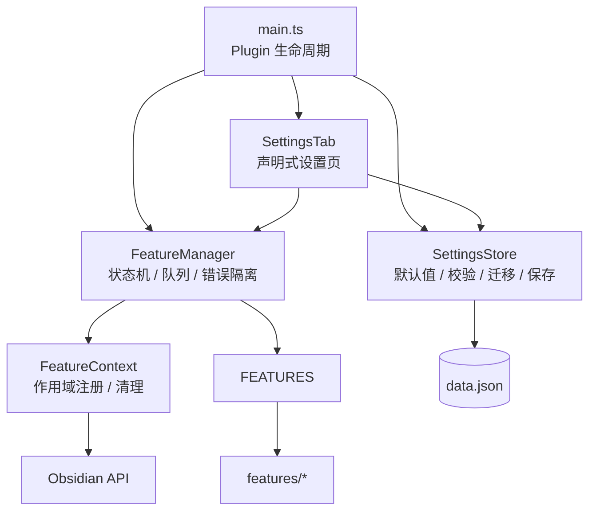

# All in One

一个面向长期维护的多特性 Obsidian 插件架构。每个特性是独立模块，拥有自己的设置章节和启用/关闭开关；关闭特性时，相关命令、事件、定时器、编辑器扩展和界面元素都会被清理。

> **状态**：实现基线 v0.1（2026-10-26）；“Markdown 演示”于 2026-10-29 加入。当前已实现“附件管理”“笔记漫游”和“Markdown 演示”，其余特性待添加。

## 这个仓库解决什么问题

多特性插件最常见的失败方式不是“功能写不出来”，而是：

- 特性之间互相耦合，改一个坏一片；
- 设置页越写越长，重复代码越来越多；
- 关闭特性后事件监听、定时器、命令仍然存在；
- 升级插件后旧配置丢失或错乱；
- 单个特性初始化失败，整个插件无法加载。

这套架构用五个约束来避免这些问题：

1. **一个特性一个模块，一份定义**：设置页、生命周期、测试都从同一份 `FeatureDefinition` 派生。
2. **启用期间只通过 `FeatureContext` 注册资源**：作用域组件负责清理，失败可回滚。
3. **设置页声明式生成**：每个特性一个原生设置章节，开关始终可见，设置由定义驱动。
4. **配置版本化**：默认值合并、类型校验、顺序迁移，升级不丢数据。
5. **特性互相独立**：共享代码进 `lib/`，不建立特性依赖图。

## 当前特性

### 附件管理

- 粘贴图片时按笔记目录结构保存到附件根目录，并在保存前逐张重命名；默认名使用笔记名 + 毫秒时间戳。
- 提供“上传附件并插入链接”命令，由用户绑定快捷键；上传默认保留原文件名，不添加笔记前缀。
- 链接遵循 Obsidian 的 wiki / Markdown 偏好，图片默认使用嵌入。
- 详见 [附件管理规格](docs/features/attachments.md)。

### 笔记漫游

- 可配置漫游路径（每行一个 Vault 相对文件夹或 Markdown 文件），留空表示整个 Vault。
- 特性启用后，左侧 Ribbon 显示骰子按钮，命令面板增加“漫游到随机笔记”；首次点击创建专用漫游标签页，之后无论当前在哪个标签页都会复用该标签页，并在阅读模式打开随机笔记。
- 关闭特性后，按钮和命令立即移除。
- 用于替代 Obsidian 自带“随机笔记”核心插件，并补上路径限定能力。
- 详见 [笔记漫游规格](docs/features/note-roaming.md)。

### Markdown 演示

- 任意 Markdown 笔记直接全屏演示，不需要添加 `---`；H1 单独成为主题页，H2 成为正文页；每个 H3 子标题各自成页，H2 没有 H3 时整段内容一页。
- 正文页默认不显示页眉，可在设置中开启 `一级-二级` 页眉；单页装不下时可上下滚动，页眉、页码和进度条保持固定。
- 使用 Obsidian 自带渲染器，代码块、公式、Mermaid、Callout、图片、嵌入和表格与阅读视图一致；正文图片按预览窗口宽度的 80% 等比例显示。
- 内容区铺满整个屏幕，页码、进度条、淡入翻页；打开即自动全屏，按 `Esc` 退出；支持命令、Ribbon 和文件右键菜单。
- 关闭特性后命令、Ribbon、右键菜单和已打开的演示全部清理。
- 详见 [Markdown 演示规格](docs/features/slides.md)。

## 文档导航

| 文档 | 内容 |
|---|---|
| [文档索引](docs/README.md) | 阅读顺序、术语、文档维护规则 |
| [特性文档](docs/features/README.md) | 已实现特性的功能、设置和验收说明 |
| [架构设计](docs/architecture.md) | 总体架构、模块边界、核心契约、设计意图总表 |
| [生命周期](docs/lifecycle.md) | 状态机、启用/关闭时序、资源清理、防绕过机制 |
| [设置页](docs/settings.md) | 章节布局、声明式控件、键映射、搜索与重置 |
| [数据与迁移](docs/data-and-migrations.md) | 数据模型、校验、保存、迁移、安全约束 |
| [开发指南](docs/development.md) | 环境、构建、调试同步、发布流程 |
| [新增特性](docs/feature-development.md) | 标准步骤、完整模板、Do/Don't、检查清单 |
| [测试策略](docs/testing.md) | Fake Host、生命周期契约测试、手动验收 |
| [ADR 索引](docs/adr/README.md) | 关键决策的背景、备选方案与代价 |

## 架构一览



更完整的架构图、模块依赖边界和设计意图说明见 [架构设计](docs/architecture.md)。

## 目录结构

```text
src/
├── main.ts
├── core/                 # 特性定义、上下文、管理器、设置存储、迁移
├── settings/             # 声明式设置页与控件键映射
├── features/             # 每个特性一个目录 + 显式注册表
├── i18n/                 # en / zh 文案
├── lib/                  # 跨特性共享的纯工具
└── styles/               # 汇总各特性 CSS
tests/                    # 单元测试与 Obsidian mock
scripts/                  # 同步到测试 Vault、文档检查等
docs/                     # 本套设计文档
```

## 开发命令

```bash
pnpm install       # 安装依赖
pnpm dev           # esbuild watch + 同步到 .env 指定的测试 Vault
pnpm build         # 类型检查 + 生产构建
pnpm lint          # ESLint
pnpm typecheck     # tsc --noEmit
pnpm test          # Vitest
pnpm check         # lint + typecheck + test
pnpm check:docs          # 文档链接与 Mermaid 结构检查
```

本地调试前，将 `.env.example` 复制为 `.env`，把 `OBSIDIAN_PLUGIN_DIR` 指向测试 Vault 中的插件目录。

## 设计原则

- **可预测**：开关打开就是完整启用，关闭就是完全清理。
- **可测试**：核心逻辑不依赖 Obsidian 运行时，UI 映射是纯数据。
- **可演进**：数据有版本，迁移有测试，破坏性变更有记录。
- **可定位**：一个特性一个目录，设置、文案、样式、测试都在附近。
- **最小权限**：特性拿不到完整 `Plugin`，只能使用 `FeatureContext` 暴露的能力。

## 文档维护

- 行为变更必须同步更新对应文档。
- 不可逆或影响多个模块的决策必须新增 ADR。
- 图表统一使用 Mermaid，以文本形式版本管理，不提交截图。
- 运行 `node scripts/check-docs.mjs` 检查相对链接和 Mermaid 代码块完整性。

## License

MIT，见 [LICENSE](LICENSE)。
