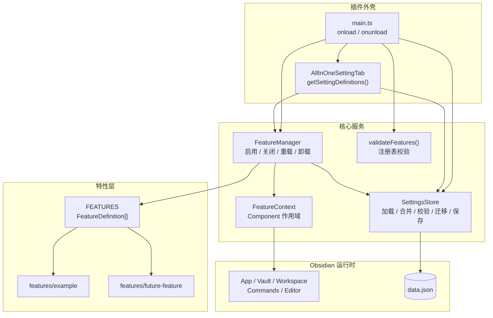
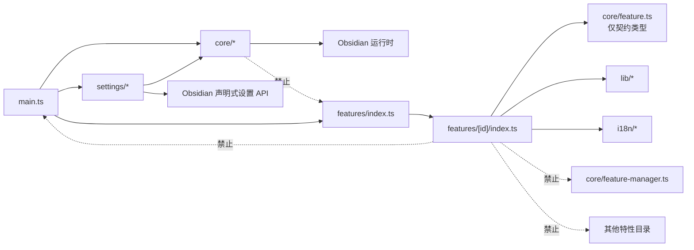

# 架构设计

> **状态**：实现基线 v0.1（2026-10-26）；“Markdown 演示”于 2026-10-29 加入。脚手架、核心架构和三个特性已落地；本文描述后续特性应遵循的架构约定。
>
> 当前注册表包含 [附件管理](features/attachments.md)、[笔记漫游](features/note-roaming.md) 和 [Markdown 演示](features/slides.md)；附件路径与命名策略见 [ADR 0006](adr/0006-attachment-path-policy.md)，演示页的 DOM 分区策略见 [ADR 0007](adr/0007-dom-rendered-slides.md)。
>
> **本文回答**：插件整体如何分层？模块之间允许怎样依赖？每个特性如何被定义、启用、配置和清理？关键设计为什么这样选？

## 1. 目标与非目标

### 目标

- 支持多个相互独立的特性，每个特性可单独启用/关闭。
- 设置页中每个特性拥有独立章节，章节内包含该特性的开关和配置项。
- 关闭特性后不残留命令、事件、定时器、编辑器扩展、Ribbon、状态栏等运行时资源。
- 新增特性不修改设置页、生命周期核心或数据存储核心。
- 配置可演进：默认值合并、类型校验、版本迁移、保存失败可恢复。
- 单个特性初始化失败不影响插件启动和其他特性。
- 核心逻辑可在不启动 Obsidian 的情况下做单元测试。

### 非目标

- 不支持运行时加载第三方特性代码。
- 不支持特性之间的依赖声明或级联开关。
- 不支持 Obsidian 1.13 以下的设置页回退实现。
- 不在本阶段实现真实业务特性；`example` 只作为架构模板。
- 不在 `data.json` 中保存密钥；未来的密钥使用 Obsidian SecretStorage。

## 2. 设计原则

1. **单一事实来源**：一个特性的元数据、默认配置、设置 schema、生命周期都集中在一个 `FeatureDefinition` 中。
2. **能力最小化**：特性拿不到完整 `Plugin`，只能使用 `FeatureContext` 暴露的能力。
3. **生命周期显式化**：启用、关闭、失败回滚、卸载都有确定顺序；资源必须可回收。
4. **数据与界面分离**：`SettingsStore` 不知道 UI，`SettingsTab` 不直接读写文件，特性不直接操作 `data.json`。
5. **默认安全**：新特性默认关闭；单个特性失败被隔离；非法配置回退默认值。
6. **可测试优先**：核心依赖窄接口和纯数据映射，避免把 Obsidian 运行时作为测试前提。
7. **文档即约束**：不可逆决策写入 ADR；行为变更同步文档。

## 3. 总体架构

### 3.1 分层图



### 3.2 简化 ASCII 图

```text
┌────────────────────────────────────────────────────────────┐
│ main.ts（组合根）                                          │
│  ├─ SettingsStore      ←→ data.json                        │
│  ├─ FeatureManager     ──→ FeatureContext × N ──→ Obsidian │
│  └─ AllInOneSettingTab ──→ 原生声明式设置页                │
└───────────────────┬────────────────────────────────────────┘
                    │ FEATURES
        ┌───────────┼───────────┐
        ▼           ▼           ▼
    example     feature-b    feature-c
   定义+设置    定义+设置     定义+设置
```

`main.ts` 是唯一的组合根：创建 Store、Manager、SettingsTab，并注册插件级资源。特性不参与组合，只提供定义和生命周期实现。

## 4. 模块职责

| 模块 | 主要职责 | 明确不负责 |
|---|---|---|
| `main.ts` | 插件入口；创建核心服务；注册设置页；启动/卸载管理器；插件级资源 | 具体特性逻辑 |
| `core/feature.ts` | `FeatureDefinition`、`FeatureSetting`、`FeatureContext` 等契约类型 | 运行时状态 |
| `core/feature-manager.ts` | 特性状态机、启用/关闭/重载、并发串行化、错误隔离、初始启用 | 设置 UI、文件格式 |
| `core/feature-context.ts` | 特性启用期间的能力集合；命令/图标/状态栏/编辑器扩展的受管注册 | 插件级资源、跨特性协调 |
| `core/settings-store.ts` | 默认值合并、校验、迁移、读写 `data.json`、防抖保存 | 设置 UI、特性生命周期 |
| `core/registry.ts` | 校验特性注册表的唯一性、ID 格式、默认值覆盖、保留键 | 运行时行为 |
| `settings/definitions.ts` | 把 `FeatureDefinition` 映射为原生 `SettingDefinitionItem[]` | 持久化、特性逻辑 |
| `settings/control-keys.ts` | 控件键的生成与解析 | 业务校验 |
| `settings/tab.ts` | `getControlValue` / `setControlValue` 路由；刷新策略；重置入口 | 具体特性 UI |
| `features/index.ts` | 显式特性注册表 `FEATURES` | 任何特性实现 |
| `features/<id>/` | 单个特性的元数据、默认值、设置、生命周期、样式、测试 | 其他特性 |
| `lib/` | 跨特性共享的纯工具 | 任一特性专属逻辑 |
| `i18n/` | 用户可见文案与语言选择 | 业务状态 |

## 5. 依赖规则



规则说明：

- `features/*` 可以导入 `core/feature.ts` 中的**类型**，但不能导入 `FeatureManager`、`SettingsStore` 或 `PluginHost`。
- `features/*` 不得导入 `main.ts`，也不得导入其他特性目录。
- `core/*` 不导入任何特性；注册表由 `main.ts` 传入。
- 共享逻辑放 `src/lib/`，不要在特性 A 中导入特性 B。
- 如果特性需要新的 Obsidian 能力，先扩展 `FeatureContext`，不要在特性里直接调用 `plugin.*`。

> **意图**：把依赖方向固定为“外壳 → 核心 → 特性契约”，避免核心反向依赖具体特性，也避免特性之间形成隐式依赖图。
>
> **代价**：新增一种全局能力时需要先改核心包装，不能随手在特性里写。
>
> **重新评估条件**：出现真实的跨特性协作需求，或需要动态加载第三方特性时。

## 6. 核心契约

### 6.1 FeatureDefinition

```ts
// src/core/feature.ts
import type { FeatureContext } from './feature-context';

export type FeatureOptions = Record<string, unknown>;

export interface FeatureDefinition<T extends FeatureOptions = FeatureOptions> {
  /** 持久化键；kebab-case；发布后不可变 */
  readonly id: string;

  /** 设置页章节标题；加载时已本地化 */
  readonly name: string;
  readonly description: string;

  /** 新安装时的默认开关状态；新特性建议 false */
  readonly defaultEnabled: boolean;

  /** 特性的默认选项；必须覆盖所有设置控件的 key */
  readonly defaultOptions: T;

  /** 设置页中的配置项；键相对于该特性 */
  readonly settings?: readonly FeatureSetting<T>[];

  /** 启用时调用；只能通过 ctx 注册资源 */
  setup(ctx: FeatureContext<T>): void | Promise<void>;

  /** 关闭时调用；用于清理 ctx 无法覆盖的资源，通常可省略 */
  teardown?(ctx: FeatureContext<T>): void | Promise<void>;

  /** 实时设置变化；apply: 'reload' 的设置不会走这里 */
  onOptionsChange?(
    ctx: FeatureContext<T>,
    changed: readonly (keyof T & string)[],
  ): void;
}
```

> **意图**：让设置页、生命周期和测试共享同一份定义。新增特性只需要新增一个定义并加入注册表。
>
> **代价**：定义必须是静态的，不能在运行时从远程生成。
>
> **重新评估条件**：需要支持第三方特性或运行时安装特性时。

### 6.2 FeatureSetting

```ts
import type {
  Setting,
  SettingDefinitionControl,
  SettingDefinitionRender,
  SettingGroup,
} from 'obsidian';

export type FeatureSetting<T extends FeatureOptions> =
  | (SettingDefinitionControl<Extract<keyof T, string>> & {
      /** live：实时生效；reload：修改后重建特性 */
      apply?: 'live' | 'reload';
    })
  | (Omit<SettingDefinitionRender, 'render'> & {
      /** 自定义设置行；可以使用当前特性的 ctx */
      render(
        setting: Setting,
        group: SettingGroup,
        ctx: FeatureContext<T>,
      ): void | (() => void);
    });
```

`FeatureSetting` 直接复用 Obsidian 原生声明式控件类型，因此天然支持：

- `toggle`、`text`、`textarea`、`number`、`slider`；
- `dropdown`、`color`、`file`、`folder`；
- `placeholder`、`validate`、`visible`、`disabled`、`aliases`；
- 通过 `render` 插入任意自定义 UI。

特性作者只写相对键，例如 `key: 'greeting'`；设置页层负责加上特性前缀。

### 6.3 FeatureContext

```ts
import { Component } from 'obsidian';
import type { App, Command, Extension } from 'obsidian';

export class FeatureContext<T extends FeatureOptions> extends Component {
  readonly featureId: string;
  readonly app: App;

  /** 实时读取当前选项；不是快照 */
  get options(): Readonly<T>;

  get logger(): Logger;

  /** 当前特性是否处于 enabled 状态 */
  isEnabled(): boolean;

  /** 写入单个选项；等价于设置页修改该项 */
  setOption<K extends keyof T & string>(key: K, value: T[K]): Promise<void>;

  /** 关闭并重新启用当前特性；用于结构性设置变化 */
  reload(): Promise<void>;

  /** 受管注册：关闭时自动回收 */
  addCommand(command: Command): void;
  addRibbonIcon(icon: string, title: string, callback: (evt: MouseEvent) => any): HTMLElement;
  addStatusBarItem(): HTMLElement;
  addEditorExtension(extension: Extension): void;

  /** 带清理的 setTimeout；关闭时自动 clearTimeout */
  setTimeout(callback: () => void, delay: number): number;

  /** 关闭时 abort；异步任务应检查或传递该信号 */
  readonly signal: AbortSignal;

  // 继承自 Component，同样会自动清理：
  // register / registerEvent / registerInterval / registerDomEvent / addChild
}
```

关键设计：

- `FeatureContext` **不暴露** `plugin`、`PluginHost`、`FeatureManager`。
- 所有资源通过 `this.register(cleanup)` 挂到作用域上；关闭时 `ctx.unload()` 统一回收。
- 命令 ID 自动加上 `${featureId}-` 前缀，避免多个特性使用 `greet` 之类的通用 ID 冲突。
- 编辑器扩展进入插件级共享可变数组，关闭时移除并调用 `workspace.updateOptions()`。
- `ctx.signal` 在关闭时 abort，用于取消网络请求、长任务和延时回调。

> **意图**：让“正确清理”成为默认行为，而不是每个特性作者的自由发挥。
>
> **代价**：特性不能直接使用 `Plugin` 的全部 API；新 API 需要先包装。
>
> **重新评估条件**：需要支持 Obsidian 新 API，或引入第三方特性代码时。

### 6.4 PluginHost

```ts
export interface PluginHost {
  readonly app: App;
  loadData(): Promise<unknown>;
  saveData(data: unknown): Promise<void>;
  addCommand(command: Command): Command;
  removeCommand(commandId: string): void;
  registerEditorExtension(extension: Extension): void;
  addRibbonIcon(icon: string, title: string, callback: (evt: MouseEvent) => any): HTMLElement;
  addStatusBarItem(): HTMLElement;
}
```

`PluginHost` 是核心与 Obsidian `Plugin` 之间的窄接口。`Plugin` 在结构上满足它；测试中使用 `FakeHost` 记录调用，不启动 Obsidian。

> **意图**：把核心逻辑从 Obsidian 运行时解耦，使生命周期和清理行为可单元测试。
>
> **代价**：新增一个宿主能力时要同时更新接口、实现和 FakeHost。
>
> **重新评估条件**：接口膨胀到难以维护，或需要直接使用 `Plugin` 的其他能力时。

### 6.5 核心服务契约

```ts
export class SettingsStore {
  static load(
    host: PluginHost,
    features: readonly FeatureDefinition[],
  ): Promise<SettingsStore>;

  get global(): Readonly<GlobalSettings>;
  isFeatureEnabled(id: string): boolean;
  getOptions<T extends FeatureOptions>(id: string): Readonly<T>;

  setFeatureEnabled(id: string, enabled: boolean): Promise<void>;
  setFeatureOption(id: string, key: string, value: unknown): Promise<void>;
  resetFeatureOptions(id: string): Promise<void>;
  setGlobal<K extends keyof GlobalSettings>(key: K, value: GlobalSettings[K]): Promise<void>;

  flush(): Promise<void>;
}

export class FeatureManager {
  setEnabled(id: string, enabled: boolean): Promise<void>;
  setFeatureOption(id: string, key: string, value: unknown): Promise<void>;
  resetFeature(id: string): Promise<void>;
  reload(id: string): Promise<void>;
  enableInitial(): Promise<void>;
  unloadAll(): void;

  isEnabled(id: string): boolean;
  getContext<T extends FeatureOptions>(id: string): FeatureContext<T> | undefined;
}
```

## 7. 启动与运行时流程

### 7.1 插件启动

```text
main.onload()
  1. validateFeatures(FEATURES)            // 开发期错误尽早暴露
  2. SettingsStore.load(host, FEATURES)    // 迁移 + 校验 + 合并默认值
  3. new FeatureManager(host, FEATURES, store)
  4. 注册共享编辑器扩展数组
  5. addSettingTab(new AllInOneSettingTab(...))
  6. await manager.enableInitial()          // 按持久化状态启用，allSettled
  7. settingsTab.update()                   // 刷新声明式定义与搜索索引
```

`enableInitial()` 对每个已启用特性独立执行；单个失败只回滚该特性，不阻止其他特性或插件启动。

### 7.2 开启特性

```text
设置页 → manager.setEnabled(id, true)
  1. 若已启用，直接返回（幂等）
  2. store.setFeatureEnabled(id, true) + flush
  3. 创建 FeatureContext 并 load()
  4. definition.setup(ctx)
  5. 成功：状态 enabled
     失败：ctx.unload() → store.setFeatureEnabled(id, false) → Notice + 日志
  6. 设置页 update()，刷新结构、可见性和搜索索引
```

### 7.3 关闭特性

```text
设置页 → manager.setEnabled(id, false)
  1. 若已关闭，直接返回（幂等）
  2. store.setFeatureEnabled(id, false) + flush
  3. definition.teardown(ctx)（可选；异常只记录）
  4. ctx.unload()
  5. 状态 disabled
  6. 设置页 update()
```

先落盘关闭、再清理资源，保证异步回调和守卫立即看到“已关闭”。

### 7.4 修改设置

```text
设置页 → manager.setFeatureOption(id, key, value)
  1. store 校验并写入内存
  2. 若该设置标记 apply: 'reload' 且特性已启用 → manager.reload(id)
     否则 → definition.onOptionsChange(ctx, [key])
  3. 防抖保存 data.json
  4. 设置页 refreshDomState()（仅刷新可见性/禁用态）
```

更多细节见 [生命周期](lifecycle.md) 和 [设置页](settings.md)。

## 8. 关键设计步骤意图总表

这张表是全局索引；局部细节见对应文档和 ADR。

| 设计步骤 | 意图 | 代价 / 权衡 | 何时重新评估 |
|---|---|---|---|
| 显式特性注册表 | 单一事实来源；设置页、生命周期、测试从同一份定义派生；新增特性不改核心 | 需要手动把特性加入 `FEATURES`；不支持运行时加载 | 需要第三方特性或动态安装时 |
| `{ enabled, options }` 分离 | 开关与配置解耦；关闭不丢配置；开关可独立持久化 | 数据多一层；迁移时要处理两个字段 | 需要按工作区/环境切换配置时 |
| 原生声明式设置页 | 原生搜索、无障碍、移动端适配；UI 映射是纯数据，易测试 | 最低 Obsidian 1.13.1；新 API 行为需实测 | 必须支持旧版 Obsidian 时 |
| 每特性一个设置 group | 满足“章节 + 开关”；开关始终可见；关闭时只留开关，页面不臃肿 | 特性很多时页面较长，依赖原生搜索 | 特性超过约 15 个或需要二级导航时改用 page |
| 作用域 `FeatureContext` | 自动清理；失败回滚；把 Obsidian API 的生命周期差异集中处理 | 特性不能直接拿 `plugin`；新 API 要先包装 | 需要新 Obsidian API 时 |
| 禁止绕过 `ctx` | 防止幽灵资源；让正确写法最自然；可测试、可审计 | 有样板成本；同 bundle 无法绝对沙箱 | 引入第三方特性代码或真正沙箱时 |
| 每特性操作串行化 | 快速连续开关无竞态；最终状态确定；避免重复注册 | 微小延迟；实现复杂度增加 | 需要并行启用大量特性时 |
| 错误隔离 | 单特性失败不拖垮插件；用户能重试 | 失败特性会被关闭，需要 Notice/日志 | 需要更细粒度降级或自动重试时 |
| 版本化设置与迁移 | 数据可演进；升级不丢配置；迁移可测试 | 每次破坏性变更要写迁移和测试 | 数据模型稳定后仍保留 |
| 特性互相独立 | 避免依赖图和级联开关；生命周期确定 | 可能有重复代码；需要提炼到 `lib/` | 出现真实跨特性依赖时 |
| 显式 i18n | 中文用户与社区发布兼顾；字符串集中管理 | 文案维护成本；语言切换需重载插件 | 只面向单一语言或需要运行时切换时 |
| 首个特性作为参考实现 | 架构可执行、可验收；新增特性有参照 | 需要维护参考实现 | 出现第二个特性、模式稳定后 |

## 9. 扩展点与例外

### 9.1 新增特性

标准流程见 [新增特性](feature-development.md)。核心步骤：

1. 新建 `src/features/<id>/index.ts`。
2. 定义 `FeatureDefinition`、默认选项和设置。
3. 用 `ctx` 实现 `setup`。
4. 把定义加入 `src/features/index.ts` 的 `FEATURES`。
5. 补 i18n、样式、测试。

### 9.2 需要新的 Obsidian 能力

先扩展 `FeatureContext`：

- 能在关闭时单独移除的 API → 加包装并 `register(cleanup)`。
- 不能单独移除的 API → 只注册一次，并用 `ctx.isEnabled()` 守卫。
- 需要插件实例的能力 → 在核心实现，不把 `plugin` 暴露给特性。

### 9.3 插件级资源

以下资源只允许在 `main.ts` 注册：

- `addSettingTab`
- 共享编辑器扩展数组的初始注册
- 未来可能出现的全局视图/后处理器注册器

### 9.4 特性间共享

共享纯工具放 `src/lib/`。如果两个特性需要共享状态，先判断是否应该合并为一个特性，或把状态提升为插件级服务；不要通过导入另一个特性来“复用”。

## 10. 常见问题

### 为什么不是一个特性一个设置标签页？

一个标签页内的原生 group 更符合“每个特性一个配置章节”的要求，开关始终可见，且只需注册一个 `PluginSettingTab`。特性数量很多时，可以把映射层从 `group` 改成 `page`，核心不变。

### 为什么不用 React / Svelte？

原生声明式设置已经覆盖搜索、无障碍和移动端布局；引入前端框架会增加包体、生命周期和样式隔离成本。只有复杂自定义 UI 才使用 `render` 逃生口。

### 为什么不支持特性依赖？

依赖会带来拓扑排序、级联开关、循环检测和“关闭 A 是否关闭 B”的产品决策。当前阶段强制特性独立，把共享代码放进 `lib/`，复杂度最低。出现真实依赖时再引入 ADR 和排序机制。

### 为什么把 `enabled` 放在 `options` 外面？

开关是生命周期状态，配置是行为参数。分开后，关闭特性可以保留配置，迁移也可以独立处理开关和选项，UI 映射更直接。

### 为什么特性拿不到 `plugin`？

Obsidian 的不同 API 生命周期差异很大，而且部分 API 注册后无法单独移除。把能力收口到 `ctx`，核心才能统一实现清理、守卫和错误回滚。详见 [生命周期](lifecycle.md) 和 [ADR 0003](adr/0003-scoped-feature-context.md)。

## 11. 相关文档

- [生命周期](lifecycle.md)
- [设置页](settings.md)
- [数据与迁移](data-and-migrations.md)
- [新增特性](feature-development.md)
- [测试策略](testing.md)
- [ADR 索引](adr/README.md)
