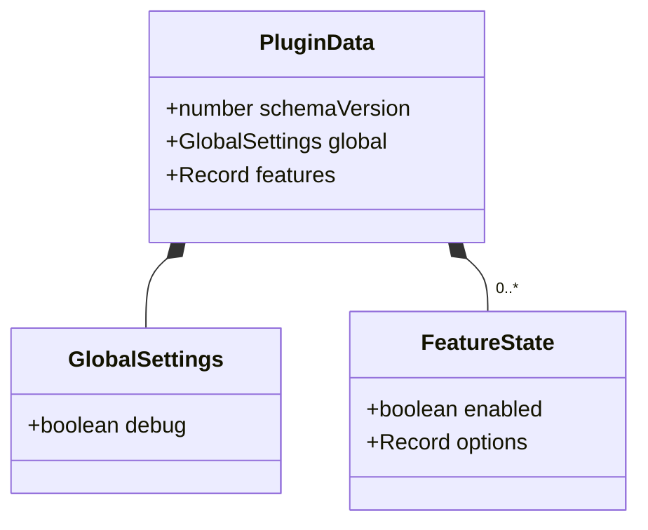
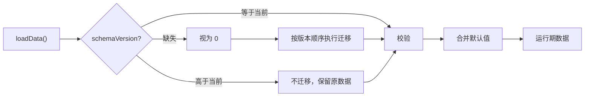

# 数据模型、校验与迁移

> **本文回答**：配置数据长什么样？默认值如何合并？非法值如何处理？保存什么时候发生？升级时如何迁移而不丢用户配置？

## 1. 数据模型



### 1.1 结构

```ts
export interface PluginData {
  schemaVersion: number;
  global: GlobalSettings;
  features: Record<string, FeatureState>;
}

export interface GlobalSettings {
  debug: boolean;
}

export interface FeatureState {
  enabled: boolean;
  options: Record<string, unknown>;
}
```

### 1.2 示例

```json
{
  "schemaVersion": 1,
  "global": {
    "debug": false
  },
  "features": {
    "example": {
      "enabled": true,
      "options": {
        "greeting": "Hello",
        "showRibbon": true,
        "output": "notice"
      }
    },
    "future-feature": {
      "enabled": false,
      "options": {}
    }
  }
}
```

### 1.3 为什么把 enabled 放在 options 外面

- 开关是生命周期状态，选项是行为参数；两者语义不同。
- 关闭特性时保留选项，重新启用后恢复。
- 迁移可以独立处理开关和选项。
- 设置页的开关键和设置键可以清晰分离。

> **意图**：避免把“是否启用”混进业务配置，导致迁移、UI 和运行时状态互相污染。
>
> **代价**：每个特性多一层对象；读取选项时要先确认特性块存在。
>
> **重新评估条件**：出现“同一特性多套配置”或“按工作区覆盖配置”的需求时。

## 2. 默认值与合并

### 2.1 默认值来源

每个特性在 `FeatureDefinition` 中声明：

```ts
defaultEnabled: false,
defaultOptions: {
  greeting: 'Hello',
  showRibbon: true,
  output: 'notice',
},
```

全局设置也有自己的默认值：

```ts
export const DEFAULT_GLOBAL_SETTINGS: GlobalSettings = {
  debug: false,
};
```

### 2.2 加载时合并

```ts
const state = persisted?.features?.[def.id];

const enabled =
  typeof state?.enabled === 'boolean'
    ? state.enabled
    : def.defaultEnabled;

const options = {
  ...structuredClone(def.defaultOptions),
  ...sanitizeOptions(def, state?.options),
};
```

规则：

- 默认值不要求用户先保存；每次加载都会合并。
- 新增选项自动获得默认值。
- 已保存的值优先于默认值。
- 保存时写入当前有效值；因此后续版本修改某个已有选项的默认值，不会自动覆盖老用户的已保存值。
- 选项建议保持扁平基础类型；嵌套对象由特性自定义校验，或整体替换。

> **意图**：新增设置不需要迁移；老配置不会因为缺字段而崩溃。
>
> **代价**：保存的是“当前有效值”，默认值调整只对新用户或新增选项自动生效。
>
> **重新评估条件**：需要让默认值变更强制影响老用户时，应写迁移而不是改默认值。

## 3. 校验

### 3.1 控件级校验

| 控件类型 | 校验规则 | 非法值处理 |
|---|---|---|
| `toggle` | 必须是 boolean | 回退默认值 |
| `text` / `textarea` | 必须是 string | 回退默认值 |
| `number` / `slider` | 有限数值；按 min/max 约束 | 回退默认值或限制到范围内 |
| `dropdown` | 值必须存在于 `options` | 回退默认值 |
| `color` | 必须是 string | 回退默认值 |
| `file` / `folder` | 必须是 string | 回退默认值 |
| `render` 自定义行 | 由特性自行校验 | 特性决定；存储层保留原值 |

### 3.2 校验层次

1. **原生控件 `validate`**：用户输入时在控件下方提示。
2. **SettingsStore 写入校验**：`setFeatureOption` / `setGlobal` 拒绝明显错误的值。
3. **加载校验**：`data.json` 可能被手工编辑或来自旧版本，加载时必须兜底。
4. **特性运行时校验**：使用 `ctx.options` 时仍需处理边界情况，不假设值一定合法。

> **意图**：UI 校验负责体验，存储校验负责数据完整性，运行时校验负责防御性编程；三者不能互相替代。
>
> **代价**：同一规则可能需要在 schema 和特性逻辑中表达两次。
>
> **重新评估条件**：出现复杂跨字段校验时，引入统一的 schema 校验库或规则对象。

## 4. 未知键与未知特性块

### 4.1 保留策略

- 未知的**特性块**保留，不删除。
- 未知的**选项键**保留，不删除。
- 未知的**全局键**保留，不删除。

原因：

- 用户降级插件时，不应丢失新版本写入的配置。
- 特性临时移除后重新加入，可以恢复原配置。
- 迁移可以按需清理，而不是加载时静默删除。

### 4.2 代价

- 数据文件可能包含已废弃字段，需要迁移定期清理。
- 未知键不会出现在设置页，用户可能困惑为什么数据里还有它。

> **意图**：把“删除用户数据”变成显式的迁移决策，而不是加载过程的副作用。
>
> **代价**：数据可能逐渐臃肿。
>
> **重新评估条件**：数据规模明显膨胀，或安全要求必须清除废弃字段时，写迁移清理。

## 5. 保存策略

| 操作 | 保存时机 | 原因 |
|---|---|---|
| 修改普通选项 | 防抖 300ms | 文本输入频繁，避免每次按键写盘 |
| 开启/关闭特性 | 立即 `flush()` | 状态必须可靠，崩溃后不能丢 |
| 重置特性设置 | 立即保存 | 用户明确操作，避免只改内存 |
| 设置页关闭 | `flush()` | 确保未提交的文本输入落盘 |
| 插件卸载 | `flush()` | 最后一次保存机会 |
| 保存失败 | 记录日志 + Notice；下次变更重试 | 不破坏内存状态 |

### 5.1 串行化

```ts
private saveChain: Promise<void> = Promise.resolve();

flush(): Promise<void> {
  this.saveChain = this.saveChain.then(
    () => this.host.saveData(this.data),
    () => this.host.saveData(this.data),
  );
  return this.saveChain;
}
```

- 所有写盘操作串行执行，避免旧请求后完成覆盖新数据。
- 防抖定时器触发时调用 `flush()`。
- `flush()` 返回 Promise，便于设置页 `hide()` 和测试等待。

### 5.2 保存失败

- 控制台记录错误，用户看到一次 Notice。
- 内存数据保持最新；下次修改会再次尝试保存。
- 不自动回滚用户输入，避免“输入消失”的更差体验。

## 6. 迁移

### 6.1 流程



版本高于当前（用户降级）时：

- 不执行迁移。
- 保留原数据。
- 按当前版本的 schema 做兼容读取；未知键保留。
- 记录一条警告，提示可能存在不兼容配置。

### 6.2 迁移框架

```ts
export const CURRENT_SCHEMA_VERSION = 1;

export type RawData = Record<string, unknown>;
export type Migration = (data: RawData) => RawData;

export const migrations: Record<number, Migration> = {
  // 2: (data) => ({
  //   ...data,
  //   schemaVersion: 2,
  //   // 具体迁移逻辑
  // }),
};

function isRecord(value: unknown): value is RawData {
  return typeof value === 'object' && value !== null && !Array.isArray(value);
}

function readVersion(data: RawData): number {
  const value = data.schemaVersion;
  return typeof value === 'number' && Number.isInteger(value) && value >= 0
    ? value
    : 0;
}

export function migrate(raw: unknown): RawData {
  let data = isRecord(raw) ? raw : {};
  let version = readVersion(data);

  if (version > CURRENT_SCHEMA_VERSION) {
    return data;
  }

  while (version < CURRENT_SCHEMA_VERSION) {
    const next = version + 1;
    const migration = migrations[next];

    if (!migration) {
      throw new Error(`Missing migration for schema version ${next}`);
    }

    data = migration(data);
    version = next;
  }

  return { ...data, schemaVersion: version };
}
```

调用方捕获异常后记录日志并回退默认数据，不要把半迁移结果写盘。

约束：

- 迁移函数必须是纯函数，不读写全局状态。
- 每个迁移只负责一个版本跨度，按顺序组合。
- 迁移失败时记录错误并回退默认数据，不写入半迁移结果。
- 迁移前不要覆盖原数据；失败时至少保留用户手工备份的可能。

### 6.3 版本升级检查清单

1. 递增 `CURRENT_SCHEMA_VERSION`。
2. 在 `migrations` 中增加以新版本号为键的迁移函数。
3. 增加“旧版本 fixture → 新版本”的单元测试。
4. 验证未知键、缺失特性块、非法值仍能加载。
5. 更新本文档和 [ADR 0004](adr/0004-versioned-settings.md)。
6. 在真实测试 Vault 中用旧 `data.json` 启动一次。

### 6.4 常见迁移场景

| 场景 | 迁移做法 |
|---|---|
| 特性新增选项 | 通常不需要迁移；默认值合并即可 |
| 选项重命名 | 读取旧键，写入新键，删除旧键 |
| 选项类型变化 | 转换值；无法转换时使用默认值 |
| 特性 ID 重命名 | 把旧特性块复制到新 ID，删除旧块；写测试 |
| 特性移除 | 默认保留块；需要清理时写显式迁移 |
| 全局设置结构变化 | 迁移 `global` 对象，保持未知键 |

> **意图**：把数据演进变成显式、可测试的步骤，而不是依赖“用户重新配置”。
>
> **代价**：每次破坏性变更都要写迁移和测试。
>
> **重新评估条件**：数据模型长期稳定后仍保留该机制；它是升级安全的基础。

## 7. 安全约束

- **不在 `data.json` 保存密钥**：它是明文文件，可能被同步、备份或分享。
- 未来的 API Key 使用 Obsidian SecretStorage；对应的设置控件需要更高的最低版本。
- 调试日志不打印完整选项对象，避免泄漏路径、Token 或个人信息。
- 迁移和错误日志只记录特性 ID、键名和错误类型，不记录值。
- `.env` 只用于本地测试 Vault 路径，必须被 `.gitignore` 忽略。

> **意图**：在数据层就避免密钥进入明文配置，减少后续泄漏面。
>
> **代价**：需要密钥的特性必须依赖 SecretStorage，增加版本要求。
>
> **重新评估条件**：Obsidian 提供更通用的安全存储 API 时。

## 8. 设计意图小结

| 选择 | 意图 | 代价 | 重新评估条件 |
|---|---|---|---|
| 单一 `data.json` | 保存简单、原子、易备份 | 所有特性共用一个文件；写放大 | 需要按特性独立同步时 |
| `{ enabled, options }` | 开关与配置解耦 | 多一层结构 | 需要多套配置时 |
| 加载时合并默认值 | 新增设置零迁移 | 默认值变更不自动影响老用户 | 需要强制默认值迁移时 |
| 类型校验 + 回退 | 手工编辑/旧版本不崩溃 | 部分非法值被静默修正 | 需要向用户报告修正时 |
| 保留未知键 | 降级和特性恢复安全 | 数据可能臃肿 | 需要清理废弃字段时 |
| 防抖 + 串行保存 | 减少写盘、避免乱序 | 崩溃时可能丢失最后几百毫秒 | 设置变更非常关键时改为立即保存 |
| 顺序迁移链 | 版本演进可测试 | 每次破坏性变更要写迁移 | 数据模型稳定后仍保留 |
| 版本高于当前不迁移 | 支持降级读取 | 可能出现不兼容行为 | 明确不支持降级时 |

## 9. 相关文档

- [架构设计](architecture.md)
- [生命周期](lifecycle.md)
- [设置页](settings.md)
- [ADR 0004：版本化设置与迁移](adr/0004-versioned-settings.md)
