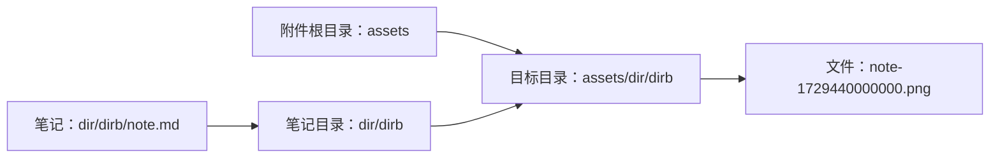
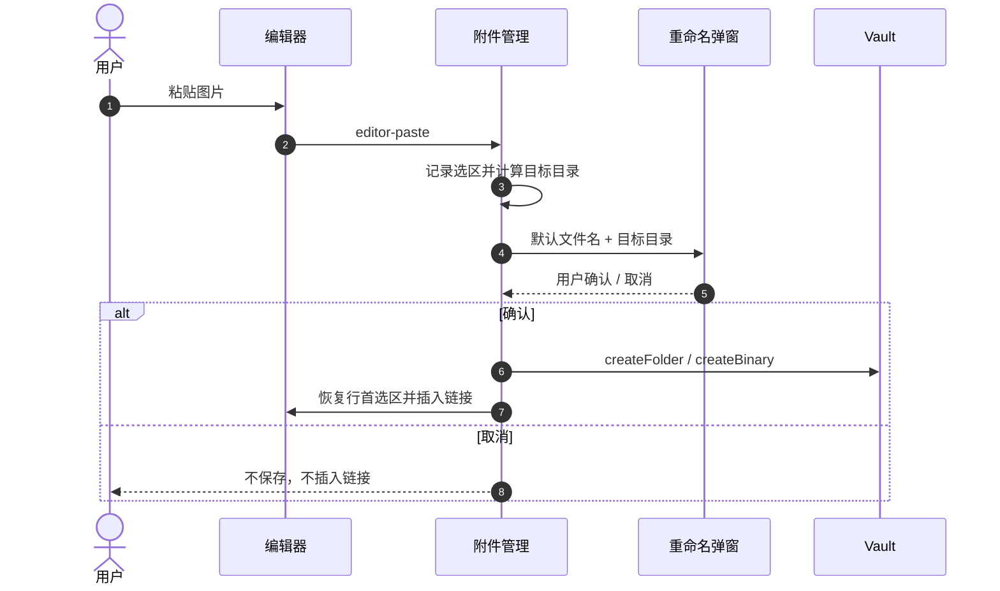
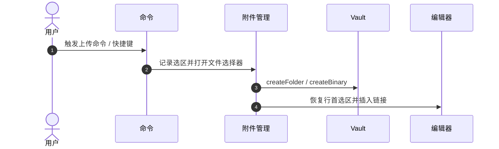

# 附件管理

> **状态**：已实现 v0.1（2026-10-20）。
>
> **本文回答**：粘贴图片和上传文件时，附件保存到哪里？文件名怎么生成？重命名弹窗如何工作？快捷键如何绑定？有哪些边界情况？

## 1. 功能概览

- 在笔记中粘贴图片时，按当前笔记的目录结构保存到附件根目录。
- 每次粘贴图片都会弹出重命名对话框；取消则整批不保存。
- 目录不存在时递归创建。
- 提供一个上传文件的命令；用户在 Obsidian 快捷键设置中绑定后，在光标处插入引用链接。
- 链接使用 Obsidian 自己的链接生成器，尊重 wiki / Markdown 链接偏好。
- 图片默认使用嵌入语法，可通过设置关闭。

特性 ID：`attachments`。首次安装默认启用；可在插件设置中关闭，关闭后粘贴恢复 Obsidian 默认行为。

## 2. 设置

| 设置 | 类型 | 默认值 | 说明 |
|---|---|---|---|
| 附件根目录 | 文件夹 | `assets` | Vault 相对路径；`/assets` 会规范化为 `assets` |
| 粘贴图片文件名模板 | 文本 | `{note}-{suffix}` | 支持 `{note}`、`{suffix}`、`{timestamp}`；`{suffix}` 是毫秒时间戳 |
| 上传文件名模板 | 文本 | `{suffix}` | 默认只保留原文件名，不添加笔记前缀 |
| 图片使用嵌入 | 开关 | 开启 | 开启插入 `![[...]]` / ``，关闭插入普通链接 |

文件名的扩展名由插件自动追加，模板中不能包含路径分隔符。

## 3. 路径算法

```text
assetsRoot = normalize(settings.assetsRoot)
noteDir    = dirname(note.path)
targetDir  = join(assetsRoot, noteDir)
fileName   = baseName + "." + extension
targetPath = join(targetDir, fileName)
```



示例：

| 笔记 | 操作 | 结果 |
|---|---|---|
| `dir/dirb/note.md` | 粘贴图片，改名为 `diagram` | `assets/dir/dirb/diagram.png` |
| `dir/dirb/note.md` | 粘贴图片，使用默认名 | `assets/dir/dirb/note-1729440000000.png` |
| `note.md` | 粘贴图片 | `assets/note-1729440000000.png` |
| `dir/dirb/note.md` | 上传 `report.pdf` | `assets/dir/dirb/report.pdf` |
| `dir/dirb/note.md` | 上传模板改为 `{note}-{suffix}` 后上传 `report.pdf` | `assets/dir/dirb/note-report.pdf` |

规则：

- 保留笔记的完整目录层级。
- 目录不存在时逐级创建。
- 目标路径已存在时追加 `-1`、`-2`；重命名对话框会先检查并提示冲突。
- 拒绝空路径、绝对路径、盘符路径和包含 `..` 的路径。
- 文件名清洗控制字符和跨平台非法字符；过长名称会截断。

## 4. 文件名模板

| Token | 含义 |
|---|---|
| `{note}` | 当前笔记文件名（不含 `.md`），已清洗 |
| `{suffix}` | 粘贴图片时为 13 位毫秒时间戳；上传文件时为原文件名（清洗后，不含扩展名） |
| `{timestamp}` | 本地时间 `YYYYMMDD-HHmmss`（不是毫秒时间戳） |

约束：

- 模板不能包含 `/` 或 `\`。
- 未知 token 会被设置页校验拒绝。
- 模板输出会做文件名清洗；最终为空时回退 `attachment`。
- 扩展名自动追加；如果用户输入的名称已经带有相同扩展名，不会重复追加。

> **意图**：粘贴和上传使用不同模板。粘贴图需要可追溯的笔记前缀和毫秒时间戳；上传文件保留原文件名，避免无意义的笔记前缀。
>
> **代价**：设置项增加为两个模板；`{suffix}` 的语义仍随场景变化。
>
> **重新评估条件**：用户希望粘贴和上传共用同一套命名规则时。

## 5. 粘贴流程



细节：

- 只处理剪贴板中的二进制图片文件；只有远程图片 HTML 时不拦截。
- 确认存在图片和当前笔记后才 `preventDefault()`，阻止 Obsidian 默认保存。
- 每张图片依次弹出重命名对话框；任意一张取消则整批中止，不创建目录、不创建文件。
- 全部名称确认后统一创建目录、保存文件、插入链接。
- 在弹窗打开前记录光标/选区位置；光标在行首时先恢复该选区再插入，非行首沿用当前选区。
- 多张图片插入多行链接。
- 处理中再次粘贴会阻止默认粘贴并提示先完成当前附件。
- 当前笔记未保存时提示先保存笔记，不拦截默认粘贴。
- 关闭特性或卸载插件时，`ctx.signal` 中止流程并关闭弹窗。

## 6. 重命名对话框

- 默认文件名来自模板渲染结果；输入框自动聚焦并全选。
- 显示目标目录和固定扩展名；扩展名不可编辑。
- 多图时显示“第 i / n 张图片”。
- 校验：
  - 非空；
  - 不含 `/`、`\`；
  - 不是 `.` 或 `..`；
  - 不含 Windows 非法字符和控制字符；
  - 不以点或空格开头/结尾；
  - 长度不超过 100；
  - 不是 Windows 保留名（如 `CON`、`COM1`）；
  - 不与本批次其他文件名重复；
  - 不与目标目录已有文件/文件夹同名。
- Enter 保存，Escape 或点击外部取消。
- 取消返回 `null`，调用方不保存任何文件。

> **意图**：在保存前完成命名，取消时不产生孤儿文件；扩展名固定避免误改文件类型。
>
> **代价**：每次粘贴都会打断编辑。
>
> **重新评估条件**：用户需要连续粘贴不被打断时，增加“仅首次询问”或设置开关。

## 7. 上传命令

命令名：“上传附件并插入链接”。插件不预设热键；在「设置 → 快捷键」中搜索该命令并绑定。

行为：

1. 仅在当前是 Markdown 编辑模式且存在笔记/编辑器时可用；其他情况命令隐藏。
2. 打开系统文件选择器，支持多选。
3. 每个文件按同一套路径规则保存；使用上传模板，`{suffix}` 是原文件名。
4. 图片根据 `embedImages` 决定嵌入或普通链接；其他文件插入普通链接。默认上传模板 `{suffix}` 不添加笔记前缀。
5. 在打开文件选择器前记录光标/选区位置；行首时关闭后恢复该选区再插入，非行首沿用当前选区。
6. 按选择顺序插入多行链接。
7. 上传文件不弹重命名对话框；文件名由上传模板决定，之后可在文件管理器中重命名，Obsidian 会更新链接。



## 8. 链接生成

使用 Obsidian 的 `FileManager.generateMarkdownLink(file, note.path)`：

- 尊重用户的 wiki / Markdown 链接偏好和相对路径设置。
- 图片且 `embedImages` 开启时，在链接前加 `!`。
- 其他文件插入普通链接。
- 链接生成异常时回退为 `[[path]]`（图片加 `!`）。
- 多文件用换行分隔。

> **意图**：不手工拼接路径，避免特殊字符、相对路径和用户偏好问题。
>
> **代价**：链接形式随用户设置变化，文档无法给出唯一形态。
>
> **重新评估条件**：需要强制固定链接格式时。

## 9. 错误与边界

| 场景 | 行为 |
|---|---|
| 无当前笔记 | 提示先保存笔记，不拦截默认粘贴 |
| 非 Markdown 编辑模式 | 上传命令隐藏 |
| 已有附件操作进行中 | 阻止新的粘贴/上传并提示 |
| 附件根目录或模板非法 | 设置页校验；运行时再次校验并提示 |
| 目录创建失败 | `Notice`，不插入链接 |
| 文件名冲突 | 对话框提示；保存竞态时追加 `-1` |
| 单张图片保存失败 | 记录日志、提示，继续处理其余图片 |
| 链接插入失败 | 提示文件已保存但链接插入失败 |
| 粘贴后撤销链接 | 只撤销编辑器内容，不删除文件 |
| 移动/重命名笔记 | 已有附件不自动移动；新粘贴按新路径保存 |
| 修改附件根目录/模板 | 只影响新附件，不迁移已有文件 |
| 剪贴板只有远程图片 URL | 不拦截，交给 Obsidian 默认行为 |
| 拖拽文件 | 本期不处理 |
| 移动端 | 文件选择器和弹窗应可用；需手动验证 |

## 10. 手动验收

1. 创建 `dir/dirb/note.md`，粘贴截图，确认弹窗、默认名形如 `note-1729440000000`、目标目录正确。
2. 改名为 `diagram`，确认文件在 `assets/dir/dirb/diagram.png`，链接为嵌入。
3. 粘贴后取消，确认没有目录、文件和链接。
4. 粘贴两张图片，确认逐张弹窗；取消第二张确认整批不保存。
5. 把光标放在空行行首，上传 `report.pdf`，确认文件在 `assets/dir/dirb/report.pdf`，链接插在该行行首。
6. 上传图片，确认嵌入；关闭 `embedImages` 后确认普通链接。
7. 根目录笔记粘贴，确认 `assets/note-<13 位毫秒时间戳>.png`。
8. 制造同名文件，确认弹窗提示；再测试竞态下的 `-1`。
9. 关闭附件管理特性，确认粘贴恢复 Obsidian 默认，上传命令消失。
10. 重启 Obsidian，确认开关和设置保留。
11. 在 wiki / Markdown 链接模式之间切换，确认链接格式跟随 Obsidian 设置。
12. 移动/重命名笔记后新粘贴，确认使用新路径，旧附件不动。

## 11. 设计意图

| 选择 | 意图 | 代价 | 重新评估条件 |
|---|---|---|---|
| 保留笔记目录结构 | 附件与笔记归属清晰，减少同名冲突 | 路径较深；移动笔记不迁移附件 | 需要扁平目录或自动迁移时 |
| 粘贴/上传分开模板 | 上传保留原名，粘贴可追溯到笔记 | 多一个设置项 | 需要共用一套规则时 |
| 粘贴使用毫秒时间戳 | 文件名可排序、冲突少 | 13 位数字较长；同一毫秒内可能重复 | 需要短随机串时 |
| 保存前逐张弹窗 | 取消不产生孤儿文件，用户完全控制名称 | 每次粘贴打断编辑 | 需要连续粘贴时 |
| 上传不弹窗 | 文件已有名称，减少交互 | 上传后改名需用文件管理器 | 上传也需要人工命名时 |
| 使用 Obsidian 链接生成器 | 尊重链接偏好，避免手拼路径 | 链接形态随设置变化 | 需要固定链接格式时 |
| 只注册命令 | 避免快捷键冲突 | 用户需手动绑定一次 | 用户明确要求默认热键时 |
| 默认开启 | 首个核心特性开箱即用 | 改变默认粘贴行为 | 面向不相关用户时改为默认关闭 |
| 失败继续处理 | 一张图片失败不阻塞其余图片 | 可能出现部分成功 | 需要严格全有或全无时 |

## 12. 非目标

- 拖拽文件到编辑器。
- 下载剪贴板中的远程图片 URL。
- 图片压缩、OCR、格式转换。
- 笔记重命名/移动时自动迁移附件。
- 附件清理、孤儿文件扫描。
- 按笔记/文件夹覆盖附件配置。
- 上传文件的重命名弹窗。
- 预设默认快捷键。

## 13. 相关文档

- [特性索引](README.md)
- [架构设计](../architecture.md)
- [生命周期](../lifecycle.md)
- [设置页](../settings.md)
- [数据与迁移](../data-and-migrations.md)
- [ADR 0006：附件路径与命名策略](../adr/0006-attachment-path-policy.md)
