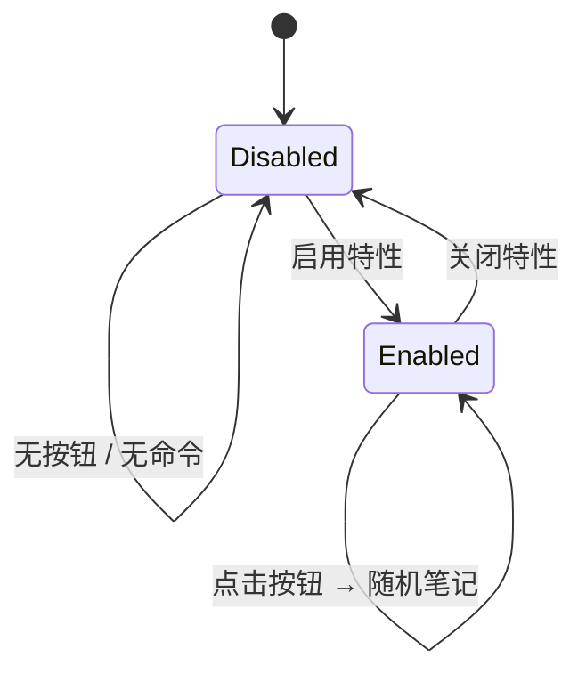

# 笔记漫游

> **状态**：已实现 v0.1（2026-10-26）。
>
> **本文回答**：如何限定漫游范围？点击侧边栏按钮后笔记在哪里打开？路径非法或没有匹配笔记时会发生什么？关闭特性后按钮为什么必须消失？

## 1. 功能概览

- 用于替代 Obsidian 自带的“随机笔记”核心插件；核心插件只能漫游整个 Vault，本特性支持限定路径。
- 启用后，左侧 Ribbon 出现骰子按钮，命令面板增加“漫游到随机笔记”。
- 点击按钮或执行命令时，从配置的路径中随机选择一篇 Markdown 笔记，并在**专用漫游标签页的阅读模式**中打开。
- 首次点击创建一个专用标签页；之后无论当前在哪个标签页，都会复用这个标签页。关闭它后，下次点击会重新创建。
- 未配置路径时，漫游整个 Vault。
- 关闭特性后，Ribbon 按钮与命令立即移除，不残留运行时行为。

特性 ID：`note-roaming`。首次安装默认关闭，需要在插件设置中手动启用。

如果你原本使用自带的“随机笔记”核心插件，建议在「设置 → 核心插件」中关闭它，避免同时出现两个随机按钮；本特性不会自动修改核心插件状态。

## 2. 设置

| 设置 | 类型 | 默认值 | 说明 |
|---|---|---|---|
| 漫游路径 | 多行文本 | 空 | 每行一个 Vault 相对文件夹或 Markdown 文件路径；留空表示整个 Vault |

路径规则：

- 文件夹包含其所有子目录；文件只匹配自身，需要写出 `.md` 扩展名。
- 多行之间取并集；重复项自动去重。
- 行首行尾空白、末尾 `/`、反斜杠会被规范化；`/notes` 等同 `notes`。
- 路径区分大小写，建议从文件管理器复制实际路径。
- 不接受绝对路径、盘符路径、UNC 路径，以及包含 `.` 或 `..` 的路径段。
- 非法行会在设置页显示行内错误；运行时忽略非法行，且**不会**因此退化为整个 Vault。

```text
notes
projects/archive
reading/list.md
```

> **意图**：用一个多行文本框覆盖“单文件夹、多文件夹、单个文件、混合”四种场景，不额外引入列表控件。
>
> **代价**：没有文件夹选择器，路径格式错误只能靠校验和提示发现。
>
> **重新评估条件**：原生设置支持可增删的文件夹列表控件时。

## 3. 路径匹配

```text
scope = parse(roamPaths)
if scope 为空：所有 Markdown 笔记
if 笔记路径 == 配置项：命中
if 笔记路径以 "配置项/" 开头：命中（配置项是文件夹）
否则：不命中
```


示例（配置为 `notes` 与 `reading/list.md`）：

| 笔记 | 命中 | 原因 |
|---|---|---|
| `notes/a.md` | 是 | 位于 `notes` 下 |
| `notes/sub/b.md` | 是 | 位于 `notes` 子目录 |
| `notes-private/c.md` | 否 | 前缀缺少 `/` 边界 |
| `reading/list.md` | 是 | 精确文件路径 |
| `reading/other.md` | 否 | 未配置该文件或文件夹 |

## 4. 打开行为

1. 读取最新的 `ctx.options.roamPaths`（设置修改后无需重载特性）。
2. 规范化路径并过滤 `vault.getMarkdownFiles()`。
3. 用 `Math.random()` 选择一篇；候选为空时显示 Notice，不创建专用标签页。
4. 获取专用标签页：
   - 如果本次启用期间已经创建过、且该叶子仍在工作区中，直接复用；
   - 否则用 `workspace.getLeaf('tab')` 新建一个，并记录叶子引用。
5. 以 `{ active: true, state: { mode: 'preview' } }` 在专用标签页中打开笔记；即使当前在别的标签页，也会切回专用标签页。
6. 打开期间忽略重复点击，避免一次点击触发多次打开。

设计取舍：

- **专用标签页**：首次创建后长期复用，不污染用户正在编辑的当前笔记；连续漫游不会累积标签页。
- **关闭后重建**：通过 `workspace.iterateAllLeaves()` 检查记录的叶子是否仍存在；用户关闭专用标签页后，下次点击自动新建。
- **普通 Markdown 标签页**：不使用自定义视图，只是记住这个 leaf；用户仍可正常编辑、拖动或关闭它。
- **阅读模式**：进入笔记即可阅读，避免随机笔记触发编辑状态或光标变化。
- **不排除当前笔记**：随机结果可能仍是专用标签页当前展示的笔记；这是可接受的随机行为，也避免额外维护历史状态。

> **意图**：把漫游固定在一个专用标签页里连续浏览，既不复用用户的工作标签页，也不每次新开。
>
> **代价**：会多一个长期存在的漫游标签页；关闭特性后它仍以普通 Markdown 标签页保留。
>
> **重新评估条件**：用户希望复用当前标签页、自动关闭漫游标签页，或需要“排除当前笔记”时。

## 5. 生命周期

- `setup` 中只注册一个命令和一个 Ribbon 图标，二者都通过 `FeatureContext` 管理。
- 专用标签页只记录在 `setup` 闭包里，不注册为受管资源；关闭特性时不会主动关闭它。
- 关闭特性时 `ctx.unload()` 移除 Ribbon 元素、注销命令并 abort `ctx.signal`。
- 重新启用时重新注册，不会出现重复按钮或重复命令；下次漫游会重新创建专用标签页。
- 插件卸载时走同一套清理路径。



## 6. 错误与边界

| 场景 | 行为 |
|---|---|
| 路径为空或只有空白 | 漫游整个 Vault |
| 路径行非法 | 设置页行内错误；运行时忽略该行，不扩大范围 |
| 所有路径行都非法 | 候选为空，Notice 提示检查路径，不漫游整个 Vault |
| 配置的路径不存在 | 候选为空，Notice 提示没有可漫游笔记 |
| Vault 中没有 Markdown 笔记 | Notice，不创建专用标签页 |
| 专用漫游标签页被关闭 | 下次点击重新创建 |
| 当前在其他标签页 | 仍切回专用漫游标签页，其他标签页不受影响 |
| 打开笔记失败 | 记录日志，Notice 提示失败原因 |
| 连续快速点击 | 第一次打开完成前的点击被忽略 |
| 特性关闭或插件卸载 | Ribbon 和命令移除；已打开的漫游标签页保留为普通笔记 |
| 随机选中当前笔记 | 允许；不维护历史记录 |
| 修改路径设置 | 下一次点击立即生效，无需重启 |

## 7. 手动验收

1. 全新安装后打开设置，确认“笔记漫游”章节只有启用开关，默认关闭。
2. 启用特性，确认左侧 Ribbon 出现骰子按钮，命令面板出现“漫游到随机笔记”。
3. 保持路径为空，点击按钮，确认新建一个专用标签页，并在阅读模式打开任意 Markdown 笔记。
4. 切换到另一个工作标签页，再次点击按钮，确认内容在专用标签页中切换，工作标签页不受影响；连续点击多次，确认专用标签页数量仍为 1。
5. 关闭专用标签页后再点击按钮，确认重新创建一个专用标签页。
6. 配置 `notes`，点击多次，确认只会选中 `notes/` 及其子目录中的笔记。
7. 追加 `reading/list.md`，确认该文件也可被选中，而 `reading/other.md` 不会被选中。
8. 输入 `/notes/`、`notes\daily`，确认被规范化后正常工作。
9. 输入 `../outside` 或 `C:\vault`，确认设置页显示行内错误。
10. 配置一个不存在的路径，确认出现“没有可漫游的 Markdown 笔记”提示且不创建专用标签页。
11. 关闭特性，确认 Ribbon 按钮消失、命令面板无残留；已打开的漫游标签页保留为普通笔记。重新启用后按钮只出现一次。
12. 重启 Obsidian，确认开关与路径保留。

## 8. 设计意图

| 选择 | 意图 | 代价 | 重新评估条件 |
|---|---|---|---|
| 多行文本路径 | 同时支持文件夹、文件和混合范围 | 无选择器，依赖校验提示 | 原生列表控件可用时 |
| 留空表示整个 Vault | 默认行为与核心插件一致 | 用户可能忘记配置 | 需要显式“全库”选项时 |
| 非法配置不退化为全库 | 避免用户以为已限定范围却被带到范围外 | 配置错误时没有可用结果 | 需要更宽松的容错时 |
| 专用标签页 + 阅读模式 | 不污染当前笔记，连续漫游复用 | 多一个长期标签页 | 需要零额外标签页时 |
| 同时注册命令与 Ribbon | 鼠标和键盘都可达 | 多一个命令项 | 只需按钮时 |
| 不维护历史/去重 | 实现简单、行为可预测 | 可能连续遇到同一篇 | 用户需要“不重复漫游”时 |

## 9. 非目标

- 自动关闭 Obsidian 自带的“随机笔记”核心插件。
- 按标签、别名、搜索条件或时间范围筛选。
- 记录漫游历史、上一页/下一页或去重。
- 给不同路径设置权重。
- 排除当前笔记或最近打开过的笔记。
- 关闭特性时自动关闭专用漫游标签页。
- 为专用标签页设置固定标题或特殊视觉标记。
- 修改、移动或创建笔记。

## 10. 相关文档

- [特性索引](README.md)
- [架构设计](../architecture.md)
- [生命周期](../lifecycle.md)
- [设置页](../settings.md)
- [数据与迁移](../data-and-migrations.md)
