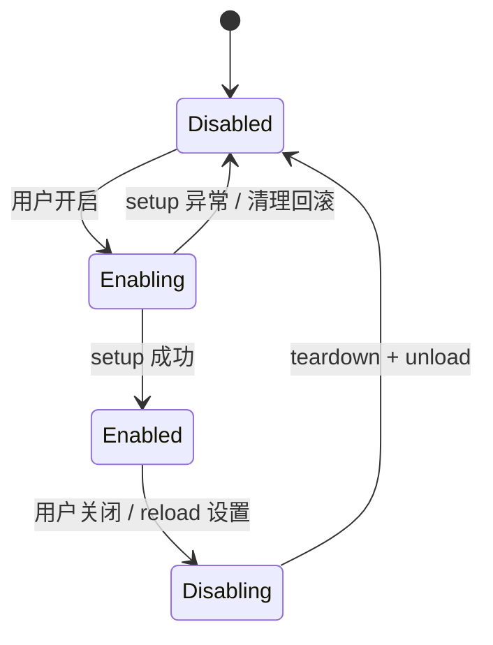
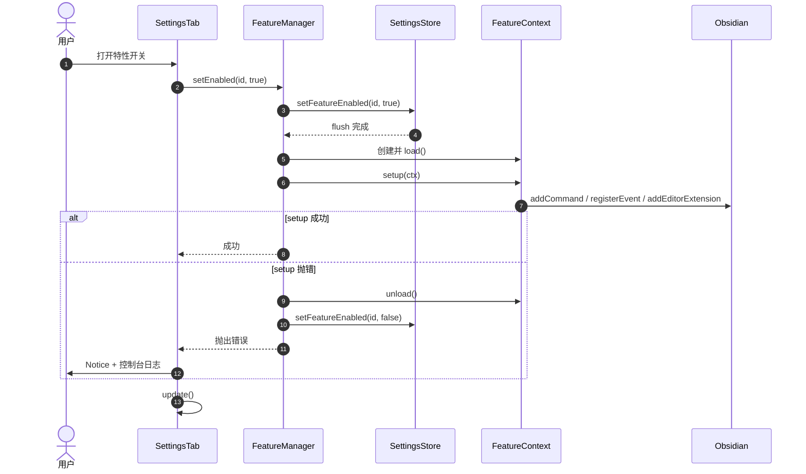
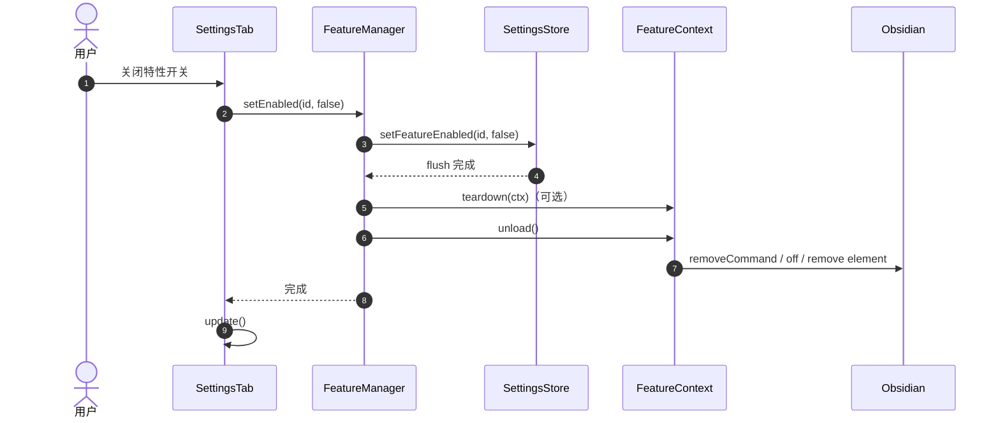

# 生命周期与资源清理

> **本文回答**：一个特性从关闭到启用、再回到关闭，经历了哪些状态？资源如何注册和回收？为什么不能绕过 `FeatureContext`？失败时如何回滚？

## 1. 核心不变量

无论用户怎样操作，下面四条必须始终成立：

1. **开关可信**：状态为“关闭”时，特性不应产生任何运行时行为。
2. **注册可回收**：启用期间注册的资源，在关闭时都必须被回收或失效。
3. **失败可回滚**：`setup` 中途抛错时，已经注册的资源不能残留。
4. **最终状态确定**：快速连续开关后，最终状态与最后一次用户意图一致。

资源回收不是“记得写 cleanup”的自觉问题，而是架构约束。`FeatureContext` 继承 Obsidian `Component`，所有注册都挂在作用域上，关闭时统一 `unload()`。

## 2. 状态机



说明：

- 持久化状态只有 `enabled: true | false`；`Enabling` / `Disabling` 是运行时过渡状态。
- `failed` 只作为日志和诊断状态存在；失败后最终回到 `Disabled`，并回滚持久化开关。
- `live` 设置不改变状态，特性保持 `Enabled`，回调读取最新 `ctx.options`。
- `reload` 被建模为一次 `disable → enable`，因此同样受状态机和队列保护；快速操作时由队列保证最终状态。

## 3. 启用时序



关键点：

- **先持久化 enabled，再 setup**：如果进程在 setup 期间崩溃，下次启动会重试，而不是悄悄丢失用户意图。
- **失败时回滚持久化状态**：避免 UI 显示“已开启”但运行时实际失败。
- **`ctx.unload()` 在回滚前执行**：保证部分注册的资源被清理。

## 4. 关闭时序



为什么要先落盘 `false` 再清理？

- 清理过程中触发的异步回调、事件处理器会立即看到 `isEnabled() === false`。
- 即使用户在清理途中关闭 Obsidian，持久化状态也已经是关闭。
- 避免“UI 已关，后台还在跑”的中间态。

`teardown` 只用于清理 `ctx` 覆盖不到的资源。它抛错不会阻止 `ctx.unload()`，只记录日志，避免一个清理异常导致其余资源泄漏。

## 5. 资源生命周期矩阵

| 资源 | 推荐 API | 底层行为 | 关闭时 |
|---|---|---|---|
| Vault / Workspace / MetadataCache 事件 | `ctx.registerEvent(ref)` | `Component.registerEvent` | 自动 `off` |
| 定时器 | `ctx.registerInterval(id)` | `Component.registerInterval` | 自动 `clearInterval` |
| 延时回调 | `ctx.setTimeout(fn, ms)` | 内部 `register(clearTimeout)` | 自动 `clearTimeout` |
| DOM 监听 | `ctx.registerDomEvent(el, type, cb)` | `Component.registerDomEvent` | 自动 `removeEventListener` |
| 子组件 | `ctx.addChild(component)` | `Component.addChild` | 自动 `unload` |
| 命令 | `ctx.addCommand(command)` | 自动加特性前缀 + `register(removeCommand)` | 从命令面板移除 |
| Ribbon | `ctx.addRibbonIcon(...)` | 返回元素 + `register(el.remove)` | 移除图标 |
| 状态栏 | `ctx.addStatusBarItem()` | 返回元素 + `register(el.remove)` | 移除元素 |
| 编辑器扩展 | `ctx.addEditorExtension(ext)` | 共享可变数组 + `updateOptions()` | 从数组移除并刷新 |
| 任意自定义清理 | `ctx.register(cleanup)` | `Component.register` | 调用 cleanup |
| 视图 / 后处理器 / 协议处理器 | 核心包装的“永久注册” | 只注册一次 + 状态守卫 | 守卫失效；视图 leaf 关闭 |
| 异步任务 | `ctx.signal` + `isEnabled()` | 关闭时 `abort()` | 任务自行退出 |

> **意图**：把“资源类型 → 清理方式”的映射集中在核心，特性作者只需要选择正确的 `ctx` 方法，不需要记住每个 Obsidian API 的卸载细节。
>
> **代价**：部分 API 需要核心先提供包装；特性不能随意直接调用 `plugin.*`。
>
> **重新评估条件**：Obsidian 新增无法包装的 API，或需要支持第三方特性代码时。

## 6. 规则澄清：不是“只能在 setup 注册”

准确的规则是：

> **特性启用期间，所有带生命周期的资源只能通过 `ctx` 注册；特性关闭后、模块顶层、插件 `onload` 中不得绕过 `ctx` 直接注册。**

允许的情况：

- 在 `setup()` 中注册；
- 在特性启用期间的事件回调中动态调用 `ctx.addCommand()`；
- 在 `onOptionsChange()` 中通过 `ctx.setOption()` 修改配置；
- 在 `teardown()` 中只做清理，不注册新资源。

禁止的情况：

- 模块顶层直接 `app.vault.on(...)`；
- 在 `main.ts` 中写某个特性专属的注册逻辑；
- 在特性里直接 `plugin.addCommand` / `plugin.registerView` / `plugin.registerEditorExtension`；
- 关闭之后仍通过捕获的 `ctx` 注册命令或事件；
- 特性 A 直接导入特性 B。

### 为什么禁止绕过 `ctx`

| 原因 | 具体后果 |
|---|---|
| 开关语义失真 | 用户关闭特性后，事件仍在跑、定时器仍触发、命令仍在面板里 |
| 重复注册 | 每次启用都新增监听器/命令，回调执行次数不断累加 |
| API 生命周期不一致 | 事件要 `off`，命令要 `removeCommand`，编辑器扩展要改数组，视图注册后无法单独移除 |
| 失败无法回滚 | `setup` 中途抛错，直接注册的资源没有任何句柄可清理 |
| 无法测试 | 直接调用 `plugin` 的代码没有测试缝，只能靠人工 review |
| 权限过大 | 特性可以误用 `addSettingTab`、`saveData` 或访问其他特性状态 |

## 7. 防绕过：五层机制

### 第 1 层：结构隔离

- `FeatureDefinition.setup(ctx)` 只接收 `FeatureContext`。
- `FeatureContext` 不暴露 `plugin`、`PluginHost`、`FeatureManager`。
- `main.ts` 不导出单例，不提供 `getPlugin()`。
- `PluginHost` 只存在于核心，特性代码禁止导入。

### 第 2 层：能力收口

所有允许的资源都有 `ctx` 包装：

- 能单独移除的：包装并 `register(cleanup)`。
- 不能单独移除的：核心只注册一次，并用 `ctx.isEnabled()` 守卫。
- 需要新 API：先扩展 `FeatureContext`，不要在特性里绕过。

### 第 3 层：ESLint

只对特性目录生效，避免影响核心：

```js
// eslint.config.mjs
{
  files: ['src/features/**/*.ts'],
  rules: {
    'no-restricted-imports': ['error', {
      patterns: [
        {
          group: [
            '**/main',
            '**/main.ts',
            '**/core/plugin-host',
            '**/core/feature-manager',
          ],
          message: '特性只能通过 FeatureContext 注册资源',
        },
      ],
    }],

    'no-restricted-syntax': ['error',
      // 直接拿 plugin / this.plugin 注册全局资源
      {
        selector: "CallExpression:matches([callee.object.name='plugin'], [callee.object.property.name='plugin'])[callee.property.name=/^(addCommand|addRibbonIcon|addStatusBarItem|registerEditorExtension|registerView|registerMarkdownPostProcessor|registerMarkdownCodeBlockProcessor|registerEditorSuggest|registerObsidianProtocolHandler|registerExtensions|registerHoverLinkSource)$/]",
        message: '特性只能通过 FeatureContext 注册资源',
      },

      // 裸定时器和 DOM 监听
      { selector: "CallExpression[callee.name='setInterval']",
        message: '请使用 ctx.registerInterval()' },

      { selector: "CallExpression[callee.name='setTimeout']",
        message: '请使用 ctx.setTimeout() 或 ctx.register(clearTimeout)' },

      { selector: "CallExpression[callee.object.name=/^(window|document)$/][callee.property.name='addEventListener']",
        message: '全局 DOM 监听请使用 ctx.registerDomEvent()' },
    ],
  },
}
```

局部 DOM 元素（例如自定义设置行里的输入框）可以使用 `addEventListener`，但必须在 `render` 返回的 cleanup 中移除。全局 `window` / `document` 监听一律走 `ctx.registerDomEvent`。

注意：`no-restricted-syntax` 无法区分 `ctx.app.vault.on(...)` 是否被 `ctx.registerEvent(...)` 包裹，也无法追踪 `const p = plugin` 这类别名。生产实现建议增加一个本地 ESLint 规则 `managed-registration`，用作用域分析强制：

1. `.vault.on` / `.workspace.on` / `.metadataCache.on` 只能作为 `ctx.registerEvent(...)` 的实参；
2. `addCommand` / `addRibbonIcon` / `addStatusBarItem` / `addEditorExtension` 等只能出现在 `ctx` 对象上；
3. 禁止从 `plugin` / `host` 派生别名，或把 `ctx` 传给其他模块；
4. 局部 `addEventListener` 必须有对应的 cleanup。

```js
// eslint-rules/managed-registration.js（本地规则，示意）
// 对每个 CallExpression：
// - callee.property.name === 'on' 且对象是 vault/workspace/metadataCache
//   → 检查 parent 是否为 ctx.registerEvent 的实参，否则报错
// - callee.property.name 属于受管注册方法
//   → 检查 callee.object 是否解析为 ctx 形参，否则报错
```

### 第 4 层：运行时断言

```ts
function assertActive(method: string) {
  if (!this.active) {
    throw new Error(
      `[${this.featureId}] ${method} called after feature disabled`,
    );
  }
}
```

配套：

- 关闭时先设置 `active = false`，再执行清理；
- `ctx.signal` 在关闭时 `abort()`；
- 清理回调逐个 `try/catch`，避免一个失败阻断后续；
- 开发模式下做资源快照，关闭后检查命令、编辑器扩展、Ribbon/状态栏元素是否回到基线。

### 第 5 层：测试与 CI

- 每个特性的生命周期契约测试：启用后资源存在，关闭后回到基线。
- 导入纯净性测试：导入特性模块时不得发生任何注册。
- CI 执行 `pnpm lint && pnpm test`，lint 失败直接阻断。

> **现实边界**：同一个 bundle 内没有真正的沙箱，`any`、动态属性访问总能绕过静态检查。目标不是防住恶意代码，而是让正确写法最自然，让绕过行为在 lint、测试和 review 中可见。

## 8. 失败处理

| 失败点 | 处理 | 持久化状态 | 用户感知 |
|---|---|---|---|
| 注册表校验失败 | 测试/CI 失败；生产记录并跳过非法特性 | 不变 | 控制台错误 |
| `setup` 抛错 | `ctx.unload()` + 回滚 enabled | `false` | Notice + 控制台 |
| `teardown` 抛错 | 记录日志，继续 `ctx.unload()` | `false` | 控制台错误 |
| `onOptionsChange` 抛错 | 记录日志，保留已保存的值 | 不变 | 控制台错误 |
| `reload` 失败 | 关闭特性，保留配置 | `false` | Notice + 设置页刷新 |
| 保存失败 | 记录日志 + Notice；下次变更重试 | 内存状态保留 | Notice |
| 迁移失败 | 记录日志，使用默认数据 | 默认数据 | 控制台错误 |
| 卸载时异步 teardown | 记录错误，继续卸载其他特性 | 不变 | 控制台错误 |

原则：**能回滚的回滚，不能回滚的记录并继续；不要让一个特性拖垮插件。**

## 9. 并发与快速开关

每个特性维护一个 Promise 队列：

```ts
private queues = new Map<string, Promise<void>>();

private enqueue(id: string, task: () => Promise<void>): Promise<void> {
  const previous = this.queues.get(id) ?? Promise.resolve();
  const next = previous.then(task, task);
  this.queues.set(id, next.catch(() => undefined));
  return next;
}
```

行为：

- 连续点击开关时，操作按顺序执行。
- 执行前检查当前状态，若已经是目标状态则跳过。
- 最后一次用户意图决定最终状态。
- `reload` 也走同一队列，避免与手动开关交叉执行。

> **意图**：异步 `setup`/`teardown` 与用户快速操作组合时，不出现“先关闭后启用又被旧任务覆盖”的竞态。
>
> **代价**：开关响应可能延迟几毫秒；实现比直接调用复杂。
>
> **重新评估条件**：特性初始化非常慢，需要并行或取消正在进行的启用流程时。

## 10. 异步任务与取消

- `setup` 尽量同步；耗时初始化放到特性内部调度，不要阻塞插件启动太久。
- 异步任务使用 `ctx.signal`：

```ts
setup(ctx) {
  void (async () => {
    const response = await fetch(url, { signal: ctx.signal });
    if (!ctx.isEnabled()) return;
    const data = await response.json();
    if (!ctx.isEnabled()) return;
    // 使用 data
  })();
}
```

- 延时任务使用 `ctx.setTimeout()`，不要裸 `setTimeout`。
- 关闭后仍可能执行的 Promise 回调，必须检查 `ctx.isEnabled()` 或 `ctx.signal.aborted`。

> Obsidian 中跨域请求通常使用 `requestUrl`。它不接受 `AbortSignal`，因此关闭后必须在每次续写前检查 `ctx.isEnabled()`，不能依赖请求被取消。

## 11. 插件卸载

```text
main.onunload()
  1. manager.unloadAll()      // 逆序关闭所有已启用特性
  2. store.flush()            // 落盘未保存的设置
```

- 逆序关闭，保证后启用的特性先清理。
- 优先同步 `teardown`；`onunload` 不能可靠等待异步清理。
- Obsidian 会回收插件级注册，但特性资源仍应先由 `ctx` 清理，避免卸载过程中触发回调。

## 12. 常见错误与症状

| 症状 | 常见根因 | 修复 |
|---|---|---|
| 关闭后命令仍在命令面板 | 直接 `plugin.addCommand` | 改用 `ctx.addCommand` |
| 关闭后文件变化仍触发逻辑 | 模块顶层或直接 `app.vault.on` | 用 `ctx.registerEvent` |
| 每次开关回调执行次数增加 | 重复注册监听器 | 检查是否在模块顶层注册；`ctx` 是否每次新建 |
| 关闭后编辑器仍有装饰/行为 | 直接 `registerEditorExtension` | 用 `ctx.addEditorExtension`，关闭时移出数组 |
| 设置页开关显示开但功能不工作 | `setup` 失败未回滚 | 失败时 `unload` + 持久化 `false` |
| 快速开关后状态错乱 | 没有串行化 | 每特性 Promise 队列 + 执行前状态检查 |
| 设置搜索找不到已启用特性的选项 | 开关后只调用了 `refreshDomState()` | 开关/重置后调用 `tab.update()` |
| 关闭后仍有异步写入 | 没有取消信号 | 使用 `ctx.signal`，回调前检查 `isEnabled()` |
| 视图类型重复注册 | 每次启用都 `registerView` | 只注册一次 + 守卫，或关闭 leaf |

## 13. 设计意图小结

| 设计 | 意图 | 代价 | 重新评估条件 |
|---|---|---|---|
| 显式状态机 | 让启用/关闭行为可描述、可测试 | 状态和转换需要维护 | 出现新的生命周期阶段时 |
| 先落盘再 setup / 先落盘再清理 | 崩溃或快速操作时状态可恢复 | 失败时多一次写盘 | 写盘成为性能瓶颈时（不太可能） |
| `FeatureContext` 作用域 | 自动清理、失败回滚、能力最小化 | 新 API 要包装 | 需要新 Obsidian 能力时 |
| 五层防绕过 | 让绕过困难且可见 | 样板、lint 规则维护 | 引入第三方特性时 |
| 每特性串行队列 | 消除快速开关竞态 | 微小延迟 | 初始化非常慢时 |
| 错误隔离 | 单特性失败不拖垮插件 | 失败特性自动关闭 | 需要自动重试或降级时 |
| 永久注册守卫模式 | 处理不可注销 API | 只能注册一次，逻辑必须读实时状态 | Obsidian 提供注销 API 时 |
| `AbortSignal` | 关闭后异步任务可取消 | 特性作者要传递信号 | 引入统一任务调度器时 |

## 14. 相关文档

- [架构设计](architecture.md)
- [设置页](settings.md)
- [数据与迁移](data-and-migrations.md)
- [新增特性](feature-development.md)
- [测试策略](testing.md)
- [ADR 0003：作用域 FeatureContext](adr/0003-scoped-feature-context.md)
