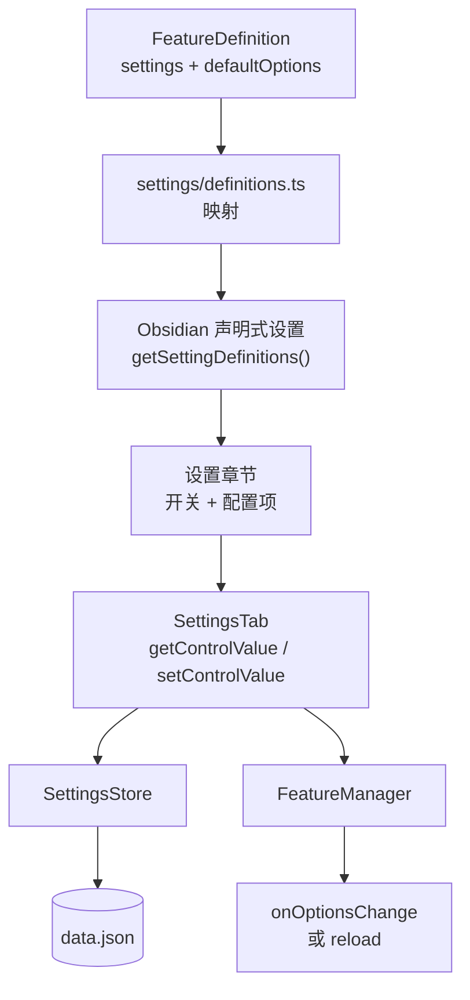

# 设置页设计

> **本文回答**：设置页如何做到“每个特性一个章节 + 一个开关”？界面如何从特性定义生成？控件值如何映射到持久化数据？什么时候刷新页面？

## 1. 需求与体验目标

- 设置页只有一个插件标签页，内部按特性分章节。
- 每个章节的标题是特性名，第一个配置项是启用开关。
- 特性关闭时只保留开关，其他配置隐藏，页面不臃肿。
- 设置项支持原生搜索、键盘操作、移动端布局和无障碍。
- 修改普通设置不丢失输入焦点；切换特性开关后立即反映可见性。
- 新增特性不需要修改设置页代码。

## 2. 为什么使用原生声明式设置

Obsidian 1.13 起，`PluginSettingTab` 支持：

```ts
getSettingDefinitions(): SettingDefinitionItem[];
getControlValue(key: string): unknown;
setControlValue(key: string, value: unknown): void | Promise<void>;
update(): void;
refreshDomState(): void;
```

设置页由数据定义生成，而不是手写 `display()`。好处：

- 原生设置搜索自动索引 `name`、`desc`、`aliases`；
- 原生无障碍、键盘导航、移动端布局；
- UI 映射是纯对象，可在 Node 环境单元测试；
- 不需要维护大量 `new Setting(...)` 样板代码。

> **意图**：把设置页从“每个特性手写 UI”变成“每个特性声明 schema，核心统一映射”。
>
> **代价**：最低 Obsidian 版本提高到 1.13.1；原生 API 的细节需要在真实环境中验证。
>
> **重新评估条件**：必须支持旧版 Obsidian，或原生 API 无法满足复杂交互时。

## 3. 页面结构

```text
┌─ General ──────────────────────────────────────────┐
│ 调试日志                                  [  ]     │
└────────────────────────────────────────────────────┘

┌─ Example Feature ──────────────────────────────────┐
│ 启用                                      [开]     │
│ 示例问候语                                [____]   │
│ 显示 Ribbon 图标                          [开]     │
│ 输出方式                                  [下拉]   │
│ 重置此特性的设置                          [按钮]   │
└────────────────────────────────────────────────────┘

┌─ Future Feature ───────────────────────────────────┐
│ 启用                                      [  ]     │
└────────────────────────────────────────────────────┘
```

规则：

- 每个特性对应一个原生 `SettingDefinitionGroup`。
- 开关行始终可见，名称是“启用”，描述是特性说明。
- 其他设置项的 `visible` 同时受“特性已启用”和自身条件控制。
- 关闭的特性只显示开关行；配置数据保留。
- 搜索可以找到特性名和描述；已启用特性的设置项在 `update()` 后进入搜索索引。

## 4. 设置页数据流



## 5. 控件键映射

`getControlValue` / `setControlValue` 使用扁平字符串键：

| 用途 | 键格式 | 示例 |
|---|---|---|
| 全局设置 | `global.<key>` | `global.debug` |
| 特性开关 | `<featureId>.$enabled` | `example.$enabled` |
| 特性选项 | `<featureId>.<optionKey>` | `example.greeting` |

约定：

- 特性 ID 只允许小写字母、数字、连字符，不能包含 `.`。
- 选项键来自 `keyof T`，不能是 `$enabled`。
- `global` 是保留的全局前缀，不能作为特性 ID。
- 解析函数 `parseControlKey` 是唯一的字符串拆解入口，避免各层各写一套。

> **意图**：原生设置框架只认识字符串键；把命名规则集中到一处，避免 UI、存储和特性代码各自拼接键。
>
> **代价**：多一层解析；键格式一旦发布就不能随意改。
>
> **重新评估条件**：需要支持嵌套选项或列表控件时，可能需要更结构化的键编码。

## 6. FeatureSetting 与映射

### 6.1 类型

```ts
export type FeatureSetting<T extends FeatureOptions> =
  | (SettingDefinitionControl<Extract<keyof T, string>> & {
      apply?: 'live' | 'reload';
    })
  | (Omit<SettingDefinitionRender, 'render'> & {
      render(
        setting: Setting,
        group: SettingGroup,
        ctx: FeatureContext<T>,
      ): void | (() => void);
    });
```

特性作者写相对键：

```ts
settings: [
  {
    name: t('features.example.greeting'),
    control: { type: 'text', key: 'greeting' },
  },
  {
    name: t('features.example.showRibbon'),
    control: { type: 'toggle', key: 'showRibbon' },
    apply: 'reload',
  },
]
```

### 6.2 生成章节

```ts
function buildFeatureGroup(
  def: FeatureDefinition,
  manager: FeatureManager,
): SettingDefinitionGroup {
  const enabled = () => manager.isEnabled(def.id);

  return {
    type: 'group',
    heading: def.name,
    cls: `aio-feature-group aio-feature-${def.id}`,
    items: [
      {
        name: t('settings.feature.enabled'),
        desc: def.description,
        control: {
          type: 'toggle',
          key: `${def.id}.$enabled`,
          defaultValue: def.defaultEnabled,
        },
      },
      ...(def.settings ?? []).map((setting) =>
        mapFeatureSetting(def, setting, manager),
      ),
      ...(def.settings?.length
        ? [{
            name: t('settings.feature.reset'),
            action: () => openResetModal(def, manager),
            visible: enabled,
          }]
        : []),
    ],
  };
}
```

`mapFeatureSetting` 的核心工作：

```ts
function mapFeatureSetting(def, setting, manager) {
  const enabled = () => manager.isEnabled(def.id);

  if ('control' in setting) {
    const optionKey = setting.control.key;
    return {
      ...setting,
      control: {
        ...setting.control,
        key: `${def.id}.${optionKey}`,
        defaultValue: def.defaultOptions[optionKey],
      },
      visible: andVisible(enabled, setting.visible),
      disabled: setting.disabled
        ? () => !enabled() || evaluate(setting.disabled)
        : undefined,
    };
  }

  return {
    ...setting,
    visible: andVisible(enabled, setting.visible),
    render: (s, group) => {
      const ctx = manager.getContext(def.id);
      return ctx ? setting.render(s, group, ctx) : undefined;
    },
  };
}
```

`mapFeatureSetting` 是示意代码；实际实现会提供 `andVisible`、`evaluate` 等小工具：

- `andVisible(base, extra)`：把“特性已启用”和设置自身的 `visible` 条件合并成一个谓词。
- `evaluate(value)`：统一处理 `boolean | (() => boolean)` 两种形式。

注意：

- `name`、`desc` 在特性定义加载时已经本地化，映射层不再处理语言。
- `visible` / `disabled` 保留原生函数形式，由 Obsidian 在渲染和 `refreshDomState()` 时求值。
- 自定义 `render` 行只有在特性启用时才可能被渲染，因此能拿到当前 `ctx`。
- 不可注销的永久注册不通过设置项完成，仍走生命周期规则。

## 7. 读取与写入

### 7.1 getControlValue

```ts
getControlValue(key: string): unknown {
  const parsed = parseControlKey(key);

  switch (parsed.kind) {
    case 'global':
      return this.store.global[parsed.key];
    case 'enabled':
      return this.store.isFeatureEnabled(parsed.featureId);
    case 'option':
      return this.store.getOptions(parsed.featureId)[parsed.key];
  }
}
```

### 7.2 setControlValue

```ts
async setControlValue(key: string, value: unknown): Promise<void> {
  const parsed = parseControlKey(key);

  if (parsed.kind === 'enabled') {
    try {
      await this.manager.setEnabled(parsed.featureId, Boolean(value));
    } catch {
      new Notice(
        t('notice.enableFailed', {
          name: this.featureName(parsed.featureId),
        }),
      );
    }
    this.update(); // 结构、可见性、搜索索引都可能变化
    return;
  }

  if (parsed.kind === 'option') {
    const wasEnabled = this.manager.isEnabled(parsed.featureId);
    await this.manager.setFeatureOption(parsed.featureId, parsed.key, value);

    if (this.manager.isEnabled(parsed.featureId) !== wasEnabled) {
      this.update(); // reload 失败导致特性被关闭
    } else {
      this.refreshDomState(); // 只更新 visible / disabled
    }
    return;
  }

  await this.store.setGlobal(parsed.key, value);
  this.refreshDomState();
}
```

要点：

- 开关失败后不抛异常给原生框架，而是 `Notice` + `update()` 让 UI 回到真实状态。
- 特性开关和重置会改变结构，必须 `update()`。
- 普通选项只调用 `refreshDomState()`，避免整页重绘和输入焦点丢失。
- `setGlobal` 走防抖保存；`setFeatureEnabled` 立即落盘。

## 8. update 与 refreshDomState 的边界

| 场景 | 调用 | 原因 |
|---|---|---|
| 打开/关闭特性 | `update()` | 配置项显隐、搜索索引、结构变化 |
| 重置特性设置 | `update()` | 多个控件值变化，可能触发 reload |
| `reload` 失败导致特性关闭 | `update()` | 章节内容需要收起 |
| 修改普通选项 | `refreshDomState()` | 只重新计算 `visible` / `disabled`，保留 DOM 和焦点 |
| 修改会影响其他选项可见性的选项 | `refreshDomState()` | 原生框架会就地更新显隐 |
| 语言变化 | `update()` | 所有文案和搜索索引需要重建 |
| 设置页关闭 | `store.flush()` | 确保文本输入已落盘 |

> **意图**：区分“结构变化”和“状态变化”，在正确性和输入体验之间取得平衡。
>
> **代价**：需要判断哪些设置会影响结构；判断错误会导致显隐不更新或光标丢失。
>
> **重新评估条件**：原生框架提供更细粒度的更新 API，或设置页出现复杂联动时。

## 9. 关闭特性时的设置展示

- 只保留开关行，其他设置项 `visible: false`。
- 数据不删除；再次启用时恢复原值。
- 重置按钮也隐藏，避免用户在关闭状态下误操作。
- 特性描述保留在开关行，搜索仍能通过描述找到该特性。

## 10. 重置

每个有设置的特性在章节底部提供“重置此特性的设置”：

- 使用 `ConfirmationModal` 二次确认，避免误触。
- 只重置选项，不改变启用状态。
- 重置后如果特性已启用，执行一次 `reload()`，确保运行时使用默认值。
- 重置后调用 `tab.update()`，让所有控件显示新值。

## 11. 自定义设置行

当原生控件无法表达时使用 `render`：

```ts
{
  name: t('features.example.advanced'),
  render(setting, group, ctx) {
    const input = setting.controlEl.createEl('input', { type: 'range' });
    const onChange = () => void ctx.setOption('threshold', Number(input.value));
    input.addEventListener('input', onChange);

    return () => input.removeEventListener('input', onChange);
  },
}
```

约束：

- 使用 `ctx.setOption()` 写值，不要直接改 Store。
- 返回清理函数；原生框架在行销毁时调用。
- 需要全局监听器时用 `ctx.registerDomEvent`。
- 自定义行也必须遵守生命周期规则，特性关闭后不能继续写值。

## 12. 错误与校验

- **原生 validate**：文本、数字、文件、文件夹控件可提供 `validate`，在控件下方显示错误。
- **存储层校验**：加载和写入时按控件类型做兜底校验；非法值回退默认值。
- **开启失败**：`FeatureManager` 回滚开关，设置页 `Notice` 并 `update()`。
- **设置 hook 失败**：记录日志，保留已保存值，不回滚用户输入。
- **保存失败**：`SettingsStore` 记录错误并 `Notice`，下次变更重试。

## 13. 未来演进

如果特性数量超过约 15 个，或章节太长：

- 把 `settings/definitions.ts` 中的 `group` 改为 `page`。
- 每个特性变成可导航子页，开关放在页面顶部。
- `SettingsStore`、`FeatureManager`、生命周期完全不变。
- 需要额外决定：是否在总览页提供快速开关列表。

> **意图**：把“页面组织方式”隔离在映射层，避免未来调整导航结构时重写核心。
>
> **代价**：多一次点击才能开关特性。
>
> **重新评估条件**：用户反馈页面过长或搜索不够用。

## 14. 设计意图小结

| 选择 | 意图 | 代价 | 重新评估条件 |
|---|---|---|---|
| 单标签页 + 每特性 group | 开关始终可见，符合“章节”要求 | 特性多时页面长 | 特性 > 15 时改用 page |
| 原生声明式设置 | 搜索、无障碍、移动端、可测试 | 最低版本 1.13.1 | 需要旧版兼容时 |
| 开关放在章节第一行 | 关闭时只留一行，页面紧凑 | 与标题分离，视觉上稍弱 | 原生 group 支持可交互标题时 |
| 关闭时隐藏其他设置 | 减少干扰 | 用户看不到特性能力 | 需要“预览配置”体验时 |
| 扁平控件键 | 与原生框架简单对接 | 键格式成为契约 | 需要嵌套/列表设置时 |
| `update()` vs `refreshDomState()` | 兼顾搜索索引和输入体验 | 需要判断结构变化 | 原生 API 变化时 |
| 重置二次确认 | 防止误操作 | 多一步交互 | 设置可轻易撤销时 |
| `render` 逃生口 | 覆盖原生控件无法表达的 UI | 自定义行需自行清理 | 原生控件覆盖所有需求时 |

## 15. 相关文档

- [架构设计](architecture.md)
- [生命周期](lifecycle.md)
- [数据与迁移](data-and-migrations.md)
- [新增特性](feature-development.md)
- [ADR 0002：原生声明式设置](adr/0002-native-declarative-settings.md)
